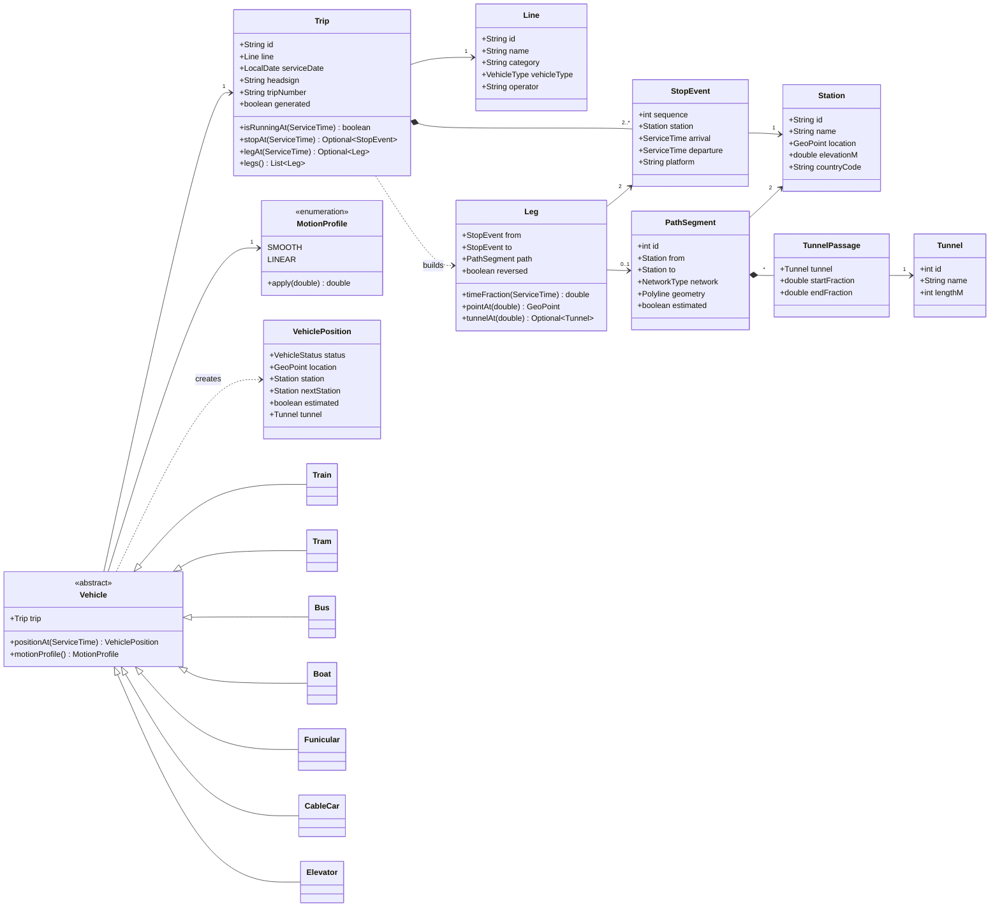

# Swiss Music Box: Domain Model

For the domain group, which builds the whole backend. This document covers **what the domain is responsible for**,
**how it is modelled in classes**, and **which REST endpoints the backend exposes on top of it**
(section 11). Services and repositories in detail come in a later document.

Language: Java 21 or later (records, sealed classes, pattern-matching `switch`).
Data source: the transport database described in [`data-group-guide.md`](data-group-guide.md).

---

## 1. What the domain is

The database stores **facts**: "IC 712 leaves Zürich HB at 09:32 and reaches Bern at 10:28,
along a 116.9 km path." The domain gives those facts **meaning**: "at 10:00, IC 712 is moving,
58.5 km out of Zürich, heading for Bern."

```
 DATA GROUP           BACKEND
 ───────────          ┌────────────────────────────────────────────────────────────┐
 PostgreSQL  ──────►  │ infrastructure   →   DOMAIN   ←   application   ←   api     │  ──►  FRONTEND
 (facts)              │ (repositories,       (this        (use cases,       (REST,   │
                      │  SQL, JDBC)          document)    services)         JSON)   │
                      └────────────────────────────────────────────────────────────┘
```

**The dependency rule:** the domain depends on nothing. It has no SQL, no Spring, no JSON and no
HTTP. Every other layer depends on the domain, never the other way round. Then the domain can be
tested with plain JUnit and fixed objects, without a database.

---

## 2. Responsibilities

The project has **two groups**:

- **The data group** turns the raw sources into the transport database and publishes it.
- **The domain group** builds the backend on top of that database: every layer, from reading the
  tables to answering HTTP requests.

### What the domain group owns

| Layer | Package | Responsible for | Example |
|---|---|---|---|
| **Domain** | `domain` | The rules: what the facts mean at a given moment (section 2.2) | `Trip.isRunningAt`, `Vehicle.positionAt` |
| **Repositories** | `infrastructure` | Reading the database with SQL/JDBC, turning rows into domain objects, keeping reference data in memory | `JdbcTripRepository` |
| **Application services** | `application` | Use cases: combining repositories and domain objects to answer one request | `VehicleTrackingService` |
| **API** | `api` | HTTP: endpoints, reading parameters, JSON, error codes (section 11) | `GET /api/v1/vehicles` |

The layers depend inwards: the API calls services, services use repositories and the domain, and
the domain depends on nothing. The repository *interfaces* belong to the domain; their SQL
*implementations* belong to infrastructure.

### Not the domain group's responsibility

| Task | Owned by |
|---|---|
| Downloading, cleaning and fixing the data | Data group |
| The database schema and its versions | Data group (agreed with the domain group: it's the contract) |
| Publishing the database image and the map files | Data group |
| Drawing the map, vehicles and 3D | The web player, a client of the API |
| Music | Later, separate |

**When the data is wrong** (a missing station, a time that goes backwards), report it to the data
group and wait for a fixed release. Don't patch data in Java: the fix would be lost on the next
release, and the two groups would disagree about what's true.

### 2.2 What the domain layer is responsible for

| The domain layer is responsible for | Example |
|---|---|
| **Representing** the network and timetable as objects that are always valid | A `Trip` can't exist with fewer than 2 stops or with time going backwards |
| **Time rules** for the service day, including after midnight | 25:10 is a valid time on the 21 Oct service day |
| **Trip state** at any time | IC 712 at 09:25: at Zürich HB; at 10:00: moving; at 13:00: not running |
| **Where a vehicle is** along its real path | 58.5 km along the Zürich → Bern track |
| **How each kind of vehicle moves** | Trains speed up and slow down; cable cars move at constant speed |
| **Which way** a vehicle travels on a shared path | Zürich → Bern and Bern → Zürich use the same stored path |
| **Tunnels**: whether a vehicle is underground | Inside the Gotthard Base Tunnel |
| **Departures** from a station | What leaves Zürich HB between 08:00 and 08:10 |
| **Odd cases** in the data, always handled the same way | Zero-minute legs, missing paths, straight-line paths, generated trips |

Within the backend, the domain layer itself doesn't do SQL (repositories), doesn't combine steps
into use cases (application services), and doesn't know about HTTP or JSON (API). Keeping it free
of all three is what makes it testable with plain JUnit.

---

## 3. Vocabulary

Use these words in code, tests and conversation, with exactly these meanings.

| Term | Meaning | Not to be confused with |
|---|---|---|
| **Station** | A place where you can board. Platforms are grouped into their station. | A platform (that's `StopEvent.platform`) |
| **Line** | A named service, e.g. IC1, S6, Bus 31 | A trip. One name can belong to several lines (S6 has 7 `line_id`s from different operators). |
| **Trip** | One run of a line on one service date, e.g. IC 712 on 21 Oct | A physical train. The data does not say which physical train runs a trip. |
| **Stop event** | A trip at one station: arrival, departure, platform | A station |
| **Leg** | The movement between two consecutive stop events | A path segment |
| **Path segment** | The real track, ferry route or rope between two stations, shared by all trips | A leg. Many legs use one path. |
| **Service date** | The timetable day a trip belongs to | The calendar date when the train is moving: a 25:10 departure happens the next morning |
| **Service time** | Seconds from the start of the service day; may exceed 24 hours | `LocalTime`, which can't go past 23:59 |
| **Vehicle** | A trip in motion: the object that knows *how* it moves | Something stored. Vehicles are created from trips when needed. |
| **Position** | Where a vehicle is at one moment, and in what state | |

---

## 4. Model overview



In words:

- **Reference data** (`Station`, `Line`, `PathSegment`, `Tunnel`) is small, the same for every
  trip, and shared. A trip *points to* it and never copies it.
- **Timetable data** is grouped in a `Trip`, which owns its `StopEvent`s (composition: a stop
  event never exists without its trip) and builds its `Leg`s from them.
- **Behaviour** lives in `Vehicle` and its subclasses, created from a `Trip` when needed and
  never stored.

---

## 5. Packages

The backend has four top-level packages, one per layer:

```
ch.usi.smb
├── domain          the rules (this section)
├── infrastructure  repository implementations: SQL, JDBC, caching
├── application     use cases: services
└── api             HTTP controllers and JSON
```

Inside `domain`:

```
ch.usi.smb.domain
├── geo         GeoPoint, Polyline
├── time        ServiceTime
├── network     Station, Line, VehicleType, PathSegment, NetworkType, Ropeway, Tunnel, TunnelPassage
├── timetable   Trip, StopEvent, Leg, Departure
├── vehicle     Vehicle, Train, Tram, Bus, Boat, Funicular, CableCar, Elevator,
│               VehicleFactory, VehiclePosition, VehicleStatus, MotionProfile
└── repository  StationRepository, LineRepository, PathSegmentRepository, TripRepository  (interfaces only)
```

Packages depend downwards only: `vehicle` uses `timetable` uses `network` uses `geo` and `time`.
`geo` and `time` depend on nothing.

---

## 6. The classes

Notation: **VO** = value object (immutable, compared by value, a `record`). **Entity** = has an
identity (compared by `id`). All classes are immutable: once built, they never change.

### 6.1 `geo`

#### `GeoPoint` (VO, record)

A point on the earth.

| Field | Type | Rule |
|---|---|---|
| `longitude` | `double` | −180 to 180 |
| `latitude` | `double` | −90 to 90 |
| `heightM` | `double` | metres above sea level |

The order is **longitude, latitude**, as in the database and the frontend. Mixing them up is the
most common geo bug.

#### `Polyline` (VO)

The shape of a path: a list of `GeoPoint`s, plus the distance from the start to every point,
calculated once when it's built.

| Method | Returns |
|---|---|
| `lengthM()` | Total length in metres |
| `pointAt(double distanceM)` | The point that far along, interpolated between the two nearest points. Clamped to the ends. |
| `reversed()` | The same line, travelled from the other end |

Rules: at least 1 point. A length of 0 is allowed (a 0 m elevator path); then `pointAt` always
returns the first point.

### 6.2 `time`

#### `ServiceTime` (VO, record, `Comparable`)

A time on the service day, stored as seconds.

| Field | Type | Rule |
|---|---|---|
| `seconds` | `int` | 0 or more; **may exceed 86,400** |

| Method | Example |
|---|---|
| `of(int hours, int minutes)` | `of(9, 32)` gives 34,320 |
| `ofSeconds(int)` | `ofSeconds(34320)` |
| `parse(String)` | `"25:10"` gives 90,600 |
| `isAfterMidnight()` | true from 24:00 |
| `isBefore`, `isAfter`, `compareTo` | |
| `secondsUntil(ServiceTime other)` | |
| `toString()` | `"09:32"`, `"25:10"`; never wraps to `"01:10"` |

**Why not `LocalTime`?** `LocalTime` can't represent 25:10. The night trains in the data run up
to 34:05 on their service day. Wrapping them would put them in the wrong day.

### 6.3 `network`

#### `Station` (entity)

| Field | Type | Notes |
|---|---|---|
| `id` | `String` | From the database; valid within one release only |
| `name` | `String` | e.g. `Zürich HB` |
| `location` | `GeoPoint` | |
| `elevationM` | `double` | |
| `countryCode` | `String` | `CH`, `DE`, `FR`, `IT`, `AT` |

| Method | |
|---|---|
| `isInSwitzerland()` | `countryCode` is `CH` |

`equals` and `hashCode` use `id` only.

#### `Line` (entity)

| Field | Type | Notes |
|---|---|---|
| `id` | `String` | |
| `name` | `String` | `IC1`, `S6`. **Not unique.** |
| `category` | `String` | `IC`, `IR`, `S`, `B`, … |
| `vehicleType` | `VehicleType` | |
| `operator` | `String` | e.g. `Schweizerische Bundesbahnen SBB` |

#### `VehicleType` (enum)

`TRAIN`, `TRAM`, `BUS`, `BOAT`, `FUNICULAR`, `CABLE_CAR`, `ELEVATOR`. Mirrors
`lines.vehicle_type` in the database exactly.

#### `NetworkType` (enum)

`TRACK`, `FERRY`, `ROPE`.

#### `Ropeway` (enum)

`CABLE_CAR`, `GONDOLA`, `CHAIR_LIFT`: what hangs from a rope.

#### `PathSegment` (entity)

The real path between two stations, stored once, travelled in both directions.

| Field | Type | Notes |
|---|---|---|
| `id` | `int` | |
| `from`, `to` | `Station` | The direction the geometry is stored in |
| `network` | `NetworkType` | |
| `geometry` | `Polyline` | |
| `estimated` | `boolean` | true = straight line; OSM had no route |
| `ropeway` | `Optional<Ropeway>` | Only on ropes |
| `tunnelPassages` | `List<TunnelPassage>` | |

| Method | |
|---|---|
| `lengthM()` | From the geometry |
| `connects(Station a, Station b)` | True for `from → to` and for `to → from` |
| `tunnelAt(double fraction)` | The tunnel at that fraction of the path (0 = `from`, 1 = `to`), if any |

#### `Tunnel` (entity)

`id`, `name` (e.g. `Gotthard-Basistunnel`), `lengthM`.

#### `TunnelPassage` (VO)

`tunnel`, `startFraction`, `endFraction`: the part of a path that's underground, as fractions of
the path's length.
Rule: `0 ≤ startFraction ≤ endFraction ≤ 1`.

### 6.4 `timetable`

#### `StopEvent` (VO, record)

| Field | Type | Rule |
|---|---|---|
| `sequence` | `int` | Order within the trip; gaps allowed |
| `station` | `Station` | |
| `arrival` | `ServiceTime` | `arrival ≤ departure` |
| `departure` | `ServiceTime` | Equal to `arrival` when the train doesn't wait |
| `platform` | `Optional<String>` | e.g. `31`, `43/44` |

| Method | |
|---|---|
| `isAt(ServiceTime t)` | `arrival ≤ t ≤ departure` |
| `dwellSeconds()` | How long it waits |

#### `Leg` (VO)

One movement between two consecutive stops. Built by `Trip`, never loaded or stored.

| Field | Type | Notes |
|---|---|---|
| `from`, `to` | `StopEvent` | Consecutive in the trip |
| `path` | `Optional<PathSegment>` | Empty for buses and trams, and where no path exists |
| `reversed` | `boolean` | True when the trip travels the path from its `to` end |

| Method | Behaviour |
|---|---|
| `isMovingAt(ServiceTime t)` | `from.departure < t < to.arrival` (strict, so the ends belong to the stations) |
| `durationSeconds()` | `to.arrival − from.departure`; **can be 0** |
| `timeFraction(ServiceTime t)` | Share of the leg's time that has passed, 0 to 1. **Returns 1 when the duration is 0.** |
| `pointAt(double distanceFraction)` | The point that share of the way along. Uses the path, reversed if needed. With no path: a straight line between the two stations. |
| `isTracked()` | True when there's a path and it isn't estimated |
| `tunnelAt(double distanceFraction)` | Converts the fraction for the travel direction (`1 − f` when reversed), then asks the path |

Rules, checked when it's built:

- `to.arrival ≥ from.departure`.
- If there's a path, it must `connect` the two stations. `reversed` must be true exactly when the
  trip goes from the path's `to` station to its `from` station.

```java
public double timeFraction(ServiceTime now) {
    int duration = durationSeconds();
    if (duration == 0) {
        return 1.0; // 278,515 legs in the data take 0 s: GTFS times are whole minutes
    }
    double fraction = (double) from.departure().secondsUntil(now) / duration;
    return Math.clamp(fraction, 0.0, 1.0);
}
```

#### `Trip` (entity, the aggregate root)

One run of a line on one service date. The only way to reach its stop events and legs.

| Field | Type | Notes |
|---|---|---|
| `id` | `String` | e.g. `20261021:…` |
| `line` | `Line` | |
| `serviceDate` | `LocalDate` | |
| `headsign` | `String` | Destination shown to passengers: `Genève-Aéroport` |
| `tripNumber` | `Optional<String>` | `712` |
| `generated` | `boolean` | Expanded from "every N seconds", not a real timetable entry |
| `stops` | `List<StopEvent>` | Sorted by `sequence`; unmodifiable |
| `legs` | `List<Leg>` | Built once from consecutive stops |

| Method | Behaviour |
|---|---|
| `origin()`, `destination()` | First and last stop |
| `firstDeparture()`, `lastArrival()` | |
| `isRunningAt(ServiceTime t)` | `firstDeparture ≤ t ≤ lastArrival` |
| `stopAt(ServiceTime t)` | The stop event the trip is at, if any. If several match (a 0-minute leg), the **last** one. |
| `legAt(ServiceTime t)` | The leg it's moving on, if any |
| `nextStopAfter(ServiceTime t)` | The next stop it will reach |
| `displayName()` | `category + " " + tripNumber`, e.g. `IC 712`; the line name when there's no number |

Rules, checked in the constructor (throw `IllegalArgumentException` with a clear message):

- At least 2 stops.
- Sequences strictly increasing.
- Time never goes backwards: each stop's arrival ≥ the previous stop's departure.

Finding the stop or leg for a time: the stops are sorted by time, so use binary search
(`Collections.binarySearch`) rather than a loop.

#### `Departure` (VO, record)

One line on a departure board: `time`, `trip`, `station`, `platform`, `headsign`.
Built from a stop event that **isn't the last stop** of its trip, because a train ending at a
station doesn't depart from it.

### 6.5 `vehicle`

#### `Vehicle` (abstract, sealed)

A trip in motion. It holds a `Trip` and knows how that kind of vehicle moves. It's created from
a trip and never stored.

```java
public abstract sealed class Vehicle
        permits Train, Tram, Bus, Boat, Funicular, CableCar, Elevator {

    private final Trip trip;

    protected Vehicle(Trip trip) {
        this.trip = Objects.requireNonNull(trip);
    }

    public Trip trip() {
        return trip;
    }

    /** Template Method: the same steps for every vehicle; only the motion profile differs. */
    public final VehiclePosition positionAt(ServiceTime now) {
        if (!trip.isRunningAt(now)) {
            return VehiclePosition.notRunning(trip);
        }
        Optional<StopEvent> stop = trip.stopAt(now);
        if (stop.isPresent()) {
            return VehiclePosition.atStation(trip, stop.get());
        }
        Leg leg = trip.legAt(now).orElseThrow(); // running and not at a stop: must be moving
        double distanceFraction = motionProfile().apply(leg.timeFraction(now));
        return VehiclePosition.moving(trip, leg, distanceFraction);
    }

    /** How this kind of vehicle covers distance over time on a leg. */
    public abstract MotionProfile motionProfile();
}
```

#### `MotionProfile` (enum)

Converts the share of a leg's time that has passed (0..1) into the share of the distance covered
(0..1). It's an enum, not hidden code, because the API sends its **name** to the frontend
(`/movements`, section 11): the domain decides how a vehicle moves, and the frontend only applies
the same curve.

```java
public enum MotionProfile {
    /** Constant speed. */
    LINEAR {
        @Override
        public double apply(double t) {
            return t;
        }
    },
    /** Slow start, slow end (smoothstep). apply(0.5) == 0.5. */
    SMOOTH {
        @Override
        public double apply(double t) {
            return t * t * (3 - 2 * t);
        }
    };

    public abstract double apply(double timeFraction);
}
```

#### The subclasses

| Class | Created for `VehicleType` | Moves | `motionProfile()` | Extra |
|---|---|---|---|---|
| `Train` | `TRAIN` | Speeds up and slows down | `SMOOTH` | `isLongDistance()`: category is IC, IR, EC, ICE, TGV, RJX |
| `Tram` | `TRAM` | Like a train, on streets | `SMOOTH` | |
| `Bus` | `BUS` | Like a tram; no paths yet, so always a straight line | `SMOOTH` | |
| `Boat` | `BOAT` | Slow start and stop at piers | `SMOOTH` | |
| `Funicular` | `FUNICULAR` | Pulled by a cable, steadily | `LINEAR` | |
| `CableCar` | `CABLE_CAR` | Constant speed on the rope | `LINEAR` | `ropeway()`, from the path |
| `Elevator` | `ELEVATOR` | Straight up | `LINEAR` | Its "path" is 0–13 m long |

A subclass is a few lines:

```java
public final class CableCar extends Vehicle {
    public CableCar(Trip trip) {
        super(trip);
    }

    @Override
    public MotionProfile motionProfile() {
        return MotionProfile.LINEAR;
    }
}
```

#### `VehicleFactory`

The one place that decides which class to create. The `switch` is checked by the compiler: adding
a `VehicleType` without a case doesn't compile.

```java
public final class VehicleFactory {
    public Vehicle create(Trip trip) {
        return switch (trip.line().vehicleType()) {
            case TRAIN -> new Train(trip);
            case TRAM -> new Tram(trip);
            case BUS -> new Bus(trip);
            case BOAT -> new Boat(trip);
            case FUNICULAR -> new Funicular(trip);
            case CABLE_CAR -> new CableCar(trip);
            case ELEVATOR -> new Elevator(trip);
        };
    }
}
```

#### `VehicleStatus` (enum)

| Value | Meaning |
|---|---|
| `NOT_RUNNING` | Before the first departure or after the last arrival |
| `AT_STATION` | Between arriving at and leaving a stop |
| `MOVING` | On a leg between two stops |

#### `VehiclePosition` (VO, record)

The answer to "where is it?". Built only through its three factory methods, so it's always
consistent.

| Field | `NOT_RUNNING` | `AT_STATION` | `MOVING` |
|---|---|---|---|
| `trip` | ✓ | ✓ | ✓ |
| `status` | ✓ | ✓ | ✓ |
| `location` | empty | the station's location | the point on the path |
| `station` | empty | the current station | empty |
| `previousStation`, `nextStation` | empty | empty | the leg's two stations |
| `legProgress` | empty | empty | distance fraction, 0 to 1 |
| `estimated` | false | false | true when the leg has no path, or its path is estimated |
| `tunnel` | empty | empty | the tunnel it's in, if any |

Use `Optional` for every field that can be empty, never `null`.

### 6.6 `repository` (interfaces only)

The domain says *what* it needs; infrastructure decides *how* (SQL). This is dependency
inversion: the domain owns the interfaces, so it never depends on the database.

```java
public interface StationRepository {
    Optional<Station> findById(String id);
    List<Station> findByName(String name);
}

public interface TripRepository {
    Optional<Trip> findById(String id);
    List<Trip> findRunningAt(LocalDate serviceDate, ServiceTime time);
    List<Departure> findDepartures(Station station, LocalDate serviceDate,
                                   ServiceTime from, ServiceTime to);
}
```

`LineRepository` and `PathSegmentRepository` follow the same pattern. The next document covers
the full list.

**Loading strategy:** reference data is small (29,653 stations, 3,141 lines, 2,538 paths, 34
tunnels on 21 Oct), so load it once at start-up and keep it in memory. Trips are big (254,588
trips, 3 million stop events per day), so load only the ones a query needs, each complete with
its stop events.

---

## 7. How a position is calculated

```
positionAt(now)
  │
  ├─ not between first departure and last arrival? ──► NOT_RUNNING
  │
  ├─ at a stop (arrival ≤ now ≤ departure)? ────────► AT_STATION (the last matching stop)
  │
  └─ otherwise on a leg (departure < now < arrival)
        1. timeFraction = time passed / leg duration    (1 if the duration is 0)
        2. distance     = motionProfile().apply(...)    (subclass decides the curve)
        3. point        = leg.pointAt(distance)         (path, reversed if needed;
                                                         straight line if no path)
        4. tunnel       = leg.tunnelAt(distance)
        ──► MOVING
```

### Odd cases

Every case below occurs in the real data. Each one is handled in exactly one place.

| Case | Size on 21 Oct | Handled by | Rule |
|---|---|---|---|
| Leg takes 0 s | 278,515 legs (mostly bus and tram) | `Leg.timeFraction` | Returns 1. The vehicle is never "moving" on it, because `from.departure < t < to.arrival` can't hold. |
| No wait at a stop (arrival = departure) | most stops | `StopEvent.isAt` | At the station for that one second only |
| Several stops match one time | follows from 0-s legs | `Trip.stopAt` | The last one wins |
| No path (bus, tram, beyond the map) | 7,101 train legs; all bus and tram legs | `Leg.pointAt` | Straight line between the stations, `estimated = true` |
| Straight-line path | 66 paths | `Leg.isTracked` | Position is `estimated` |
| Path of length 0 | elevators | `Polyline.pointAt` | Always the first point |
| Times after 24:00 | 44,750 stop events, up to 34:05 | `ServiceTime` | Kept as they are; never wrapped |
| Generated trips | 62,781 trips | `Trip.generated` | Behave normally; flagged so the frontend or API can treat them differently |
| Foreign stations | 5,690 stations | `Station.isInSwitzerland` | Normal stations, labelled |
| Gaps in `sequence` | trips crossing the border | `Trip` | Only increasing order is required |

---

## 8. Design decisions

| Decision | Why |
|---|---|
| **`Trip` is stored; `Vehicle` is not** | The data describes scheduled runs, not physical trains: about 80% of GTFS trips have no `block_id`, so one physical train can't be followed across runs. A `Train` object means "a train running this trip". Positions change every second, so they're calculated, never stored. |
| **Subclasses for vehicle kinds, an enum for vehicle type, a string for category** | Subclasses exist where *behaviour* differs (how it moves). `VehicleType` is a fixed list from the database. IC vs IR is *data*, not behaviour, so it doesn't get its own subclass. No `IcTrain extends Train`. |
| **Template Method in `Vehicle`** | The steps for finding a position are the same for every vehicle; only the motion curve differs. Each subclass writes one method. |
| **`MotionProfile` as an enum** | The curve has a name the API can send, so the frontend animates with exactly the curve the domain chose, without copying any vehicle rules. |
| **`sealed` `Vehicle`, `switch` in `VehicleFactory`** | The compiler checks that every `VehicleType` has a class. Adding a type without handling it fails at compile time. |
| **Factory instead of `new Train(...)` everywhere** | One place decides which class to create, so callers never test the vehicle type themselves. |
| **Everything immutable; records for value objects** | Safe to share between threads and requests; no "half-built" objects; `equals` for free. |
| **Rules checked in constructors** | An invalid `Trip` can't exist, so no other method has to check again. |
| **`Trip` is the aggregate root** | Stop events and legs are reached only through their trip, so a trip is always complete and consistent. |
| **Reference data shared, not copied** | Hundreds of trips use the Zürich–Bern path; they point to one `PathSegment` object. |
| **`ServiceTime` instead of `LocalTime`** | Service times go past 24:00. |
| **Repository interfaces in the domain** | The domain is testable without a database, and the database can change without touching the domain. |
| **`Optional`, never `null`** | Every "might be missing" is visible in the method's type. |

---

## 9. From database to classes

| Table | Class | Notes |
|---|---|---|
| `stations` | `Station` | `latitude`, `longitude`, `elevation_m` become one `GeoPoint` plus `elevationM` |
| `lines` | `Line` | `vehicle_type` becomes `VehicleType` |
| `path_segments` | `PathSegment` | `points` (JSON `[[lon, lat, height], …]`) becomes a `Polyline` |
| `tunnels` | `Tunnel` | |
| `segment_tunnels` | `TunnelPassage` | Added to their `PathSegment` |
| `trips` | `Trip` | `first_departure_s` and `last_arrival_s` are for fast SQL only; `Trip` recalculates them from its stops |
| `stop_events` | `StopEvent` | `next_segment_id` and `next_reversed` go into the `Leg` that starts at this stop |
| *(none)* | `Leg` | Built by `Trip` |
| *(none)* | `Vehicle`, subclasses, `VehiclePosition` | Created when needed |
| `dataset_release` | *(not in the domain)* | Shown by the API as "data version" |

---

## 10. Test cases

Use real IC 712 on 21 Oct as a fixture, built by hand in the test, not loaded from the database.
Times are service times.

| Stop | Arrives | Leaves | Path to next stop |
|---|---|---|---|
| St. Gallen | 08:07 | 08:07 | 9,578 m |
| … | | | |
| Winterthur | 08:52 | 08:54 | 19,905 m, reversed |
| Zürich Flughafen | 09:07 | 09:09 | 4,811 m |
| Zürich Oerlikon | 09:14 | 09:15 | 5,236 m |
| Zürich HB | 09:22 | 09:32 | 116,926 m, not reversed |
| Bern | 10:28 | 10:34 | 31,062 m |
| … | | | |
| Genève-Aéroport | 12:37 | 12:37 | (last stop) |

| Time | Expected status | Expected detail |
|---|---|---|
| 08:00 | `NOT_RUNNING` | before the first departure |
| 08:07 | `AT_STATION` | St. Gallen |
| 09:00 | `MOVING` | Winterthur → Zürich Flughafen; time 46.2%, distance 44.2%, about 8,806 m |
| 09:25 | `AT_STATION` | Zürich HB |
| 10:00 | `MOVING` | Zürich HB → Bern; time 50%, distance 50%, about 58,463 m |
| 12:37 | `AT_STATION` | Genève-Aéroport |
| 13:00 | `NOT_RUNNING` | after the last arrival |

More tests to write:

- **Values:** `ServiceTime.parse("25:10")` gives 90,600 and prints `"25:10"`.
- **Motion profiles:** `SMOOTH.apply(0)`, `(0.5)` and `(1)` give 0, 0.5 and 1; a `CableCar` at
  50% of the time is 50% of the way.
- **0-second leg:** `timeFraction` is 1; the vehicle is `AT_STATION` at the later stop.
- **Reversed path:** a leg with `reversed = true` at distance 0 is at the path's `to` station.
- **No path:** the position is on the straight line between the stations and `estimated`.
- **Invalid trips:** fewer than 2 stops, decreasing sequence, or time going backwards each throw
  `IllegalArgumentException`.
- **Departures:** a trip's last stop never appears as a departure.
- **Factory:** every `VehicleType` creates the expected class.

---

## 11. REST API

The domain exposes no endpoints itself: it's plain Java, with no HTTP. The endpoints live in the
**API layer**, which calls an application service, which uses the domain:

```
HTTP request → API controller → application service → domain objects → result → JSON
              (endpoints)       (use case)            (the rules)
```

### Conventions

| Topic | Rule |
|---|---|
| Base path | `/api/v1/` |
| Date | Service date, ISO format: `date=2026-10-21` |
| Time | Service time, `HH:MM`: `time=09:32`. Values past 24:00 such as `25:10` are valid (`ServiceTime.parse`). |
| Seconds in responses | Fields ending in `S` (`departS`, `arriveS`) are service-time seconds, like the database |
| Vehicle type filter | `type=TRAIN`, the `VehicleType` names; can repeat: `type=TRAIN&type=BOAT` |
| Missing values | Omitted or `null` in JSON, matching `Optional.empty()` in the domain |

### Reference data

| Endpoint | Returns | Domain used |
|---|---|---|
| `GET /release` | Data version and available service dates | — (from `dataset_release`) |
| `GET /stations?name=Zürich` | Matching stations | `StationRepository.findByName` |
| `GET /stations/{id}` | One station | `Station` |
| `GET /lines?name=IC1` | Matching lines; one name can match several | `Line` |
| `GET /paths/{id}` | One path's geometry and tunnel passages | `PathSegment`, `Polyline` |
| `GET /paths?ids=109,116,…` | Several paths at once, so the frontend can cache them | `PathSegment` |
| `GET /tunnels` | All tunnels | `Tunnel` |

### Timetable

| Endpoint | Returns | Domain used |
|---|---|---|
| `GET /trips/{id}` | One trip with all its stops | `Trip`, `StopEvent` |
| `GET /stations/{id}/departures?date=…&from=08:00&to=08:10` | Departure board | `Departure` (never a trip's last stop) |

### Vehicles

| Endpoint | Returns | Domain used |
|---|---|---|
| `GET /vehicles?date=…&time=10:00&type=TRAIN` | Every running vehicle's position at that moment | `TripRepository.findRunningAt`, `VehicleFactory`, `Vehicle.positionAt` |
| `GET /trips/{id}/position?time=10:00` | One vehicle's position | `Vehicle.positionAt` |

One vehicle, as returned by both endpoints (the location values are illustrative):

```json
{
  "tripId": "20261021:…",
  "displayName": "IC 712",
  "headsign": "Genève-Aéroport",
  "vehicleType": "TRAIN",
  "status": "MOVING",
  "location": { "longitude": 7.9, "latitude": 47.2, "heightM": 450 },
  "previousStation": "Zürich HB",
  "nextStation": "Bern",
  "legProgress": 0.5,
  "estimated": false,
  "tunnel": null
}
```

These fields are `VehiclePosition` (section 6.5), plus `displayName` and `headsign` from the trip.

### Animation

| Endpoint | Returns | Domain used |
|---|---|---|
| `GET /movements?date=…&from=08:00&to=08:30&type=TRAIN` | Every leg that is moving at some point in the window | `Trip.legs()`, `Vehicle.motionProfile()` |

```json
{
  "tripId": "20261021:…",
  "displayName": "IC 712",
  "vehicleType": "TRAIN",
  "pathId": 109,
  "reversed": false,
  "departS": 34320,
  "arriveS": 37680,
  "motion": "SMOOTH",
  "estimated": false
}
```

When a leg has no path, `pathId` is `null` and the frontend draws a straight line between
`fromStation` and `toStation`, which are included in that case.

**Why `/movements` is needed as well as `/vehicles`.** On the projector a day lasts about
3 minutes, so 8 service minutes pass every real second, and about 5,000 vehicles run at 08:00.
Asking `/vehicles` 60 times a second for 5,000 positions is far too much traffic. `/movements`
describes each leg once, with its path, direction, times and motion profile; the frontend then
moves each vehicle smoothly by itself, fetching the paths once with `/paths?ids=…`.

| Endpoint | Use it for |
|---|---|
| `/vehicles` | The exact answer for one moment: "click a train" views, checking, tests |
| `/movements` | The full-speed animation |

### Errors

| Case | Response |
|---|---|
| Unknown station, trip or path | `404 Not Found` |
| Bad date or time (`time=9h`) | `400 Bad Request`, with a message saying what was wrong |
| `from` after `to` | `400 Bad Request` |
| A date not in this data release | `404 Not Found`, with the available dates |

The map files (street tiles, terrain, relief, fonts) never go through these endpoints. The
frontend loads them directly as files (see the data group guide).

---

## 12. Next document

- Application services: `VehicleTrackingService` (`/vehicles`, `/movements`),
  `DepartureBoardService`, `TripService`.
- The full repository interfaces and their SQL implementations.
- Paging and limits: how many results one request may return.
- The show clock: playing service time 04:00 → 28:00, so the night isn't lost.
